# How to use Shramik Passbook (श्रमिक पासबुक कैसे चलाएँ)

Open the app on your phone: [wst2002.github.io/shramik-passbook](https://wst2002.github.io/shramik-passbook/)

हर कदम में पहली लाइन हिंदी में है, दूसरी लाइन अंग्रेज़ी में।
Each step has one Hindi line and one English line.

The pictures use sample names and dummy numbers (99999 00001, 99999 00002). They are not real people.

## Contents

1. [Start the app](#1-start-the-app)
2. [The home screen](#2-the-home-screen)
3. [Add today's work](#3-add-todays-work)
4. [Ask the contractor to confirm](#4-ask-the-contractor-to-confirm)
5. [What the contractor sees](#5-what-the-contractor-sees)
6. [Add the confirmation](#6-add-the-confirmation)
7. [My days](#7-my-days)
8. [Wage ledger](#8-wage-ledger)
9. [Registration prep](#9-registration-prep)
10. [Settings](#10-settings)

---

## 1. Start the app

**अपना नाम लिखें और "शुरू करें" दबाएँ।**
**Write your name and tap "शुरू करें" (Start).**

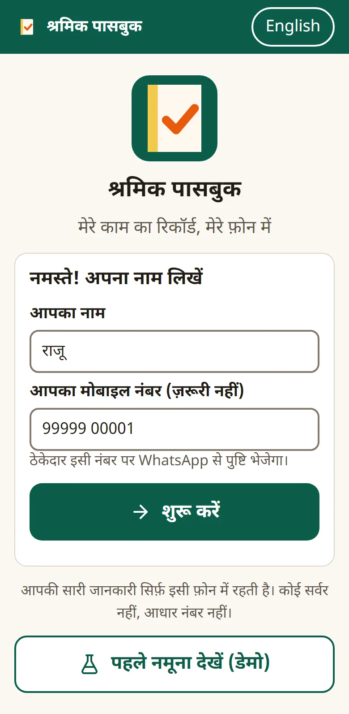

- Mobile number is optional. The contractor sends the confirmation back to this number on WhatsApp.
- Everything stays on this phone. No server, no Aadhaar number.
- Want to look around first? Tap **"पहले नमूना देखें (डेमो)"** (See a sample first). Sample data shows a yellow banner, and it never mixes with your real days.

## 2. The home screen

**घेरे का बड़ा नंबर = ठेकेदार से पुष्टि हुए दिन, 90 में से।**
**The big number in the ring = days confirmed by the contractor, out of 90.**

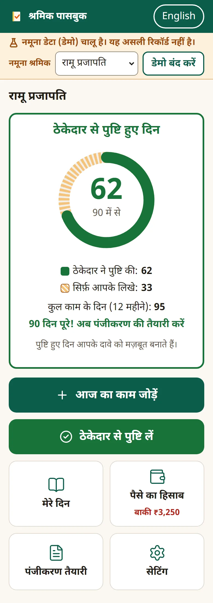

- **Green part of the ring** = days the contractor confirmed. **Striped part** = days only you wrote (self-reported).
- **कुल काम के दिन (12 महीने)** = all your work days in the last 12 months. Below it the app says how many more days you need for 90, or "90 दिन पूरे!" when you have them.
- Buttons: **आज का काम जोड़ें** (add today's work), **ठेकेदार से पुष्टि लें** (ask the contractor), then **मेरे दिन** (my days), **पैसे का हिसाब** (wages, with money still due), **पंजीकरण तैयारी** (registration prep) and **सेटिंग** (settings).

## 3. Add today's work

**"आज का काम जोड़ें" दबाएँ। फिर बोलें या एक लाइन में लिखें।**
**Tap "आज का काम जोड़ें" (Add today's work). Then speak, or type one line.**

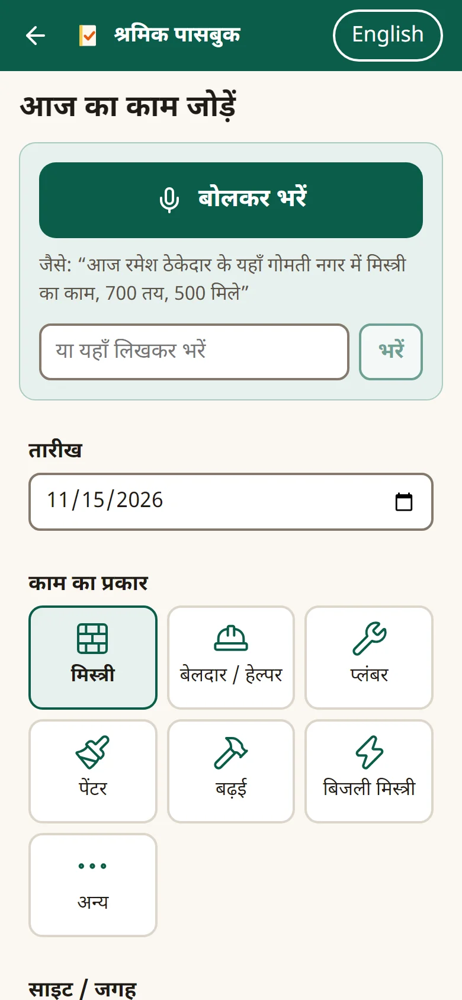

- Tap **बोलकर भरें** (Fill by speaking) and say your day, for example: "आज रमेश ठेकेदार के यहाँ लंका में मिस्त्री का काम, 700 तय, 500 मिले".
- Or type the same line in the box and tap **भरें** (Fill). Typing works without internet too.

**ऐप सारी जानकारी भर देता है। एक बार जाँच लें, फिर "सेव करें" दबाएँ।**
**The app fills the boxes. Check them once, then tap "सेव करें" (Save).**

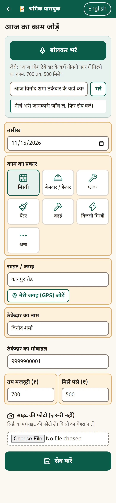

- Boxes filled from your words have an orange border. Change anything that is wrong.
- Add the contractor's mobile number once. Next time the form starts with your last entry, so a repeat day is quick.
- Optional: **मेरी जगह (GPS) जोड़ें** (add my location) and a site photo. Take photos of the work only, no faces.

**साइट (काम की जगह) लिखना ज़रूरी है।**
**The site (place of work) is required.**

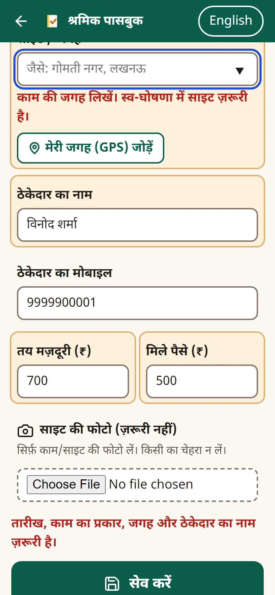

- Date, type of work, site and contractor name are required. The app shows a red line next to any box that is missing.
- The same contractor on the same date cannot be added twice.

## 4. Ask the contractor to confirm

**"ठेकेदार से पुष्टि लें" दबाएँ और ठेकेदार चुनें।**
**Tap "ठेकेदार से पुष्टि लें" (Ask the contractor) and choose the contractor.**

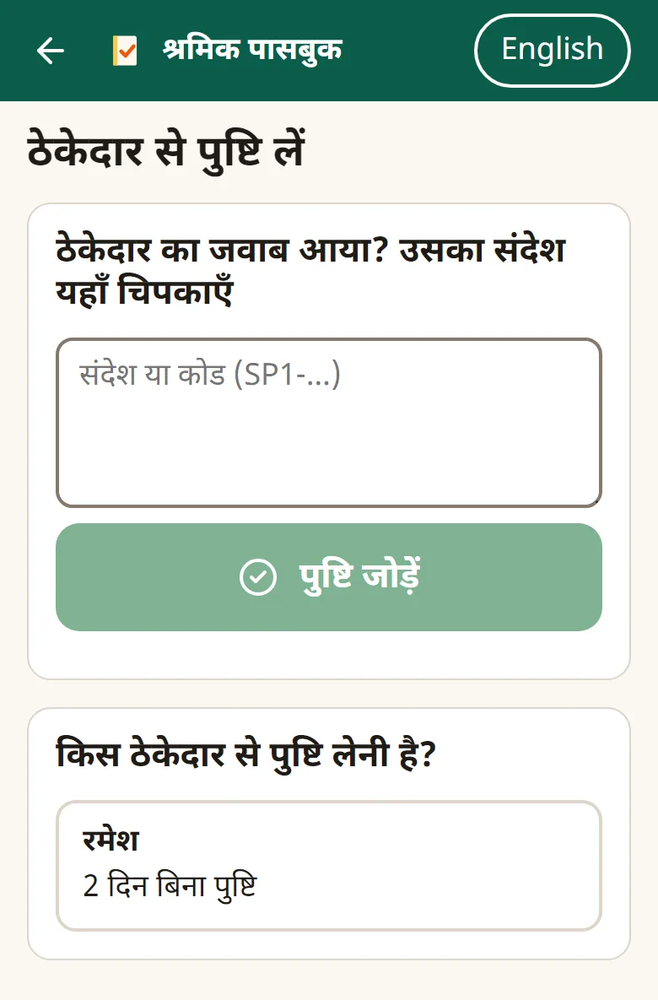

- Each contractor shows how many of your days are not confirmed yet.

**दिन चुनें और "WhatsApp पर भेजें" दबाएँ।**
**Choose the days and tap "WhatsApp पर भेजें" (Send on WhatsApp).**

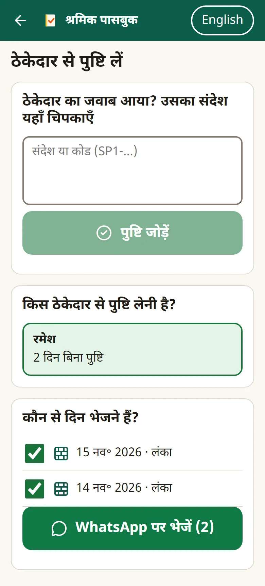

- WhatsApp opens with a ready message to the contractor's number. If there is no number, pick the contractor in WhatsApp yourself.
- The message looks like this (the link carries the days, nothing is stored on any server):

```text
नमस्ते रमेश जी, मैं राजू। मैंने आपके यहाँ 2 दिन काम किया। कृपया इस लिंक पर दिन देखकर पुष्टि करें (1 मिनट):
https://wst2002.github.io/shramik-passbook/confirm/#…
```

## 5. What the contractor sees

**ठेकेदार लिंक खोलता है और आपके दिन हिंदी में देखता है।**
**The contractor opens the link and sees your days in Hindi.**

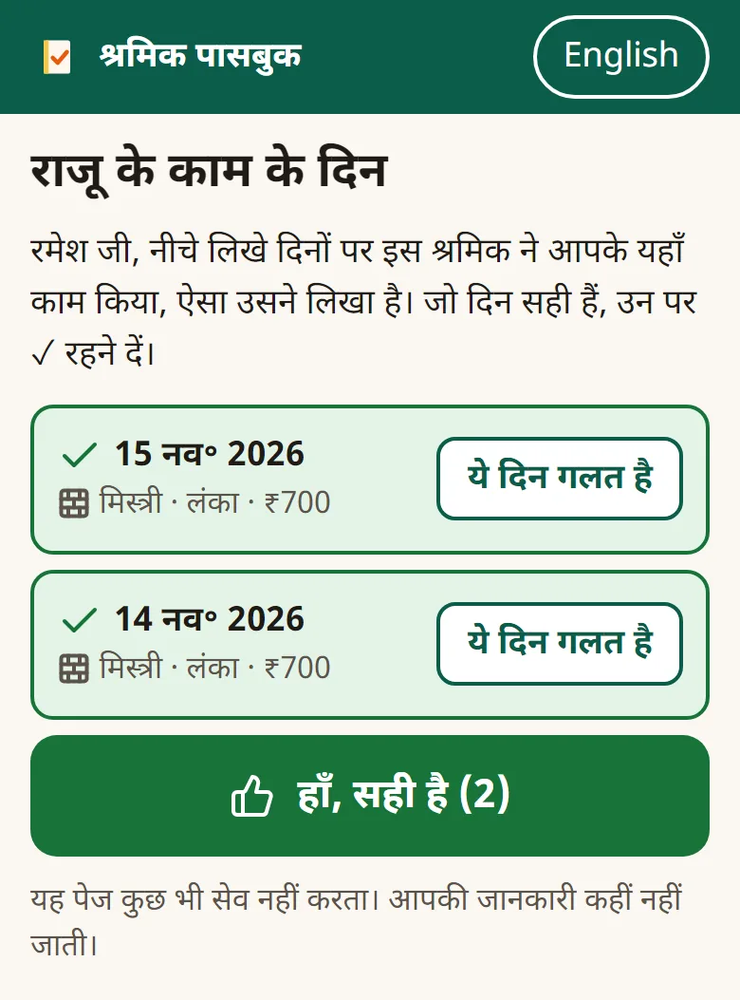

- The contractor needs no app and no account. The page saves nothing.

**गलत दिन पर "ये दिन गलत है" दबाएँ, फिर "हाँ, सही है"।**
**For a wrong day tap "ये दिन गलत है" (This day is wrong), then "हाँ, सही है" (Yes, it is correct).**

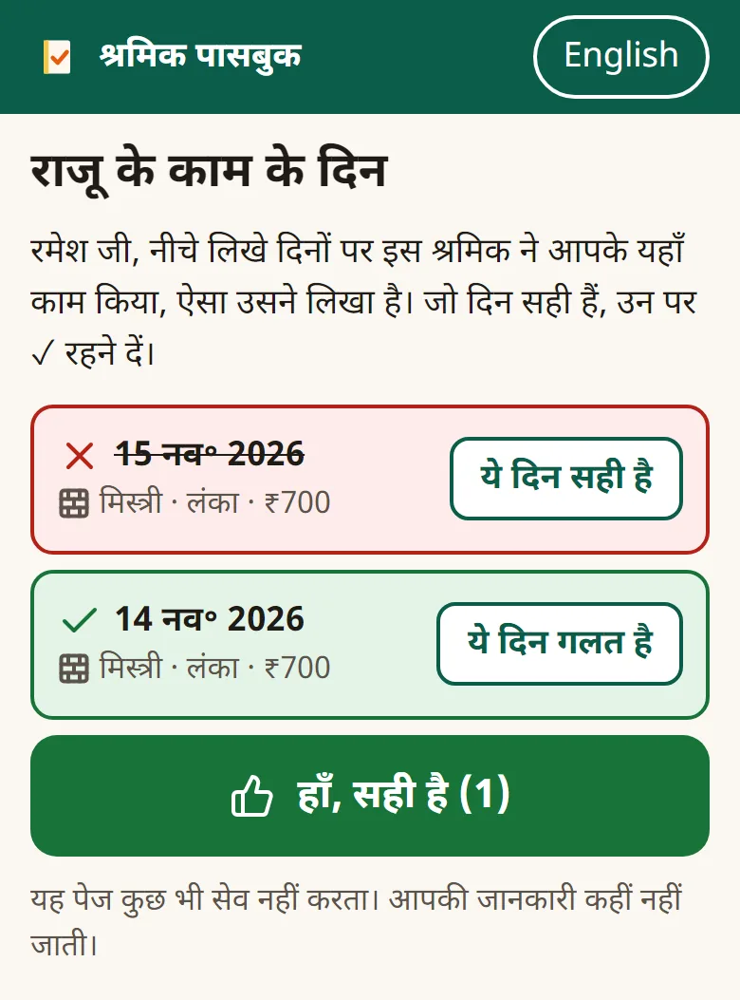

- Only the ticked days get confirmed. Here one day was marked wrong, so 1 day is confirmed.

**ठेकेदार को एक कोड मिलता है। वह हरा बटन दबाकर आपको WhatsApp पर भेजता है।**
**The contractor gets a code and sends it back to you with the green WhatsApp button.**

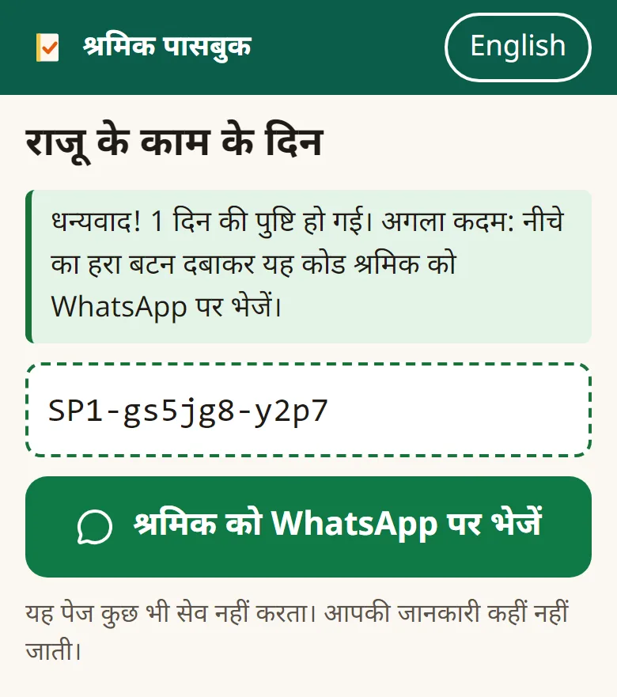

The message you get looks like this:

```text
रमेश ने राजू के 1 दिन के काम की पुष्टि की।
कोड: SP1-gs5jg8-y2p7
श्रमिक पासबुक में खोलें: https://wst2002.github.io/shramik-passbook/#code=SP1-gs5jg8-y2p7
```

## 6. Add the confirmation

**ठेकेदार के संदेश का लिंक दबाएँ, या पूरा संदेश चिपकाएँ। फिर "पुष्टि जोड़ें"।**
**Tap the link in the contractor's message, or paste the whole message. Then tap "पुष्टि जोड़ें" (Add confirmation).**

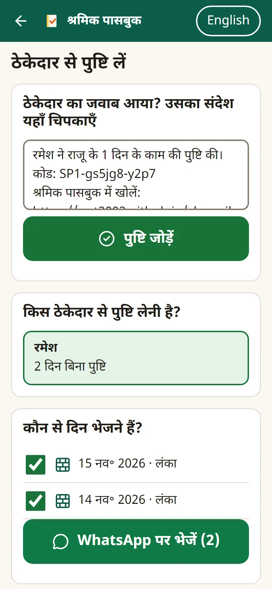

- The link opens the app with the code already filled in.
- The box is on the **ठेकेदार से पुष्टि लें** screen.

**वे दिन "ठेकेदार ने पुष्टि की" बन जाते हैं।**
**Those days are now marked "ठेकेदार ने पुष्टि की" (confirmed by contractor).**

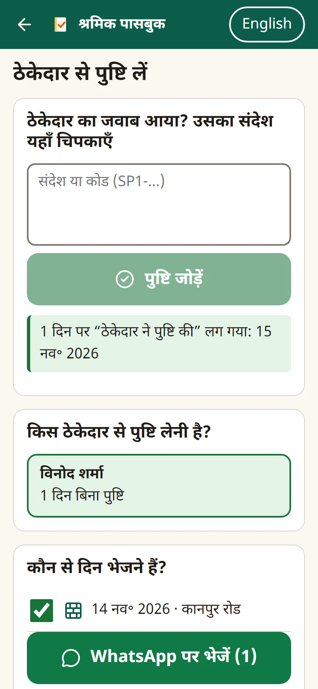

**होम पर घेरा बढ़ जाता है।**
**The ring on the home screen goes up.**

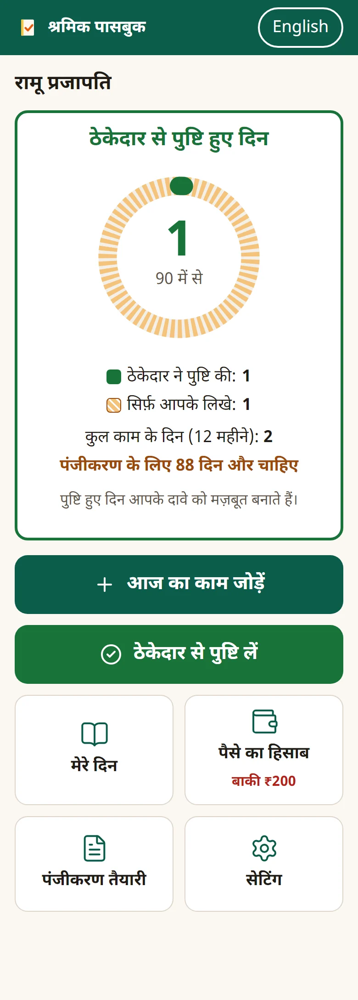

- Adding the same code again does nothing; the app says it was already added.

## 7. My days

**"मेरे दिन" में हर दिन का पूरा रिकॉर्ड है।**
**"मेरे दिन" (My days) shows every day you saved.**

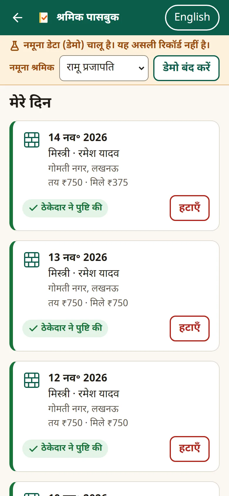

- Each day shows date, work, contractor, site, wage agreed and wage paid, and its proof level: **आपने लिखा** (you wrote it), **फोटो जुड़ी** (photo added) or **ठेकेदार ने पुष्टि की** (contractor confirmed).
- **हटाएँ** (Delete) removes a wrong day after asking you.

## 8. Wage ledger

**"पैसे का हिसाब" में देखें कितना पैसा बाकी है।**
**"पैसे का हिसाब" (Wage ledger) shows how much money is still due.**

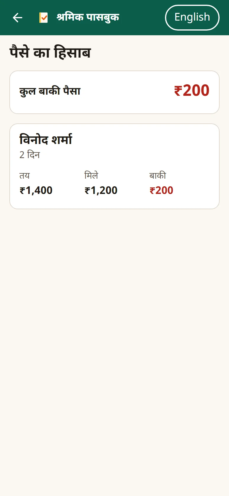

- For each contractor: days, wage agreed (तय), paid (मिले) and still due (बाकी).

## 9. Registration prep

**"पंजीकरण तैयारी" में UP BOCW पंजीकरण की सूची है।**
**"पंजीकरण तैयारी" (Registration prep) has the UP BOCW registration checklist.**

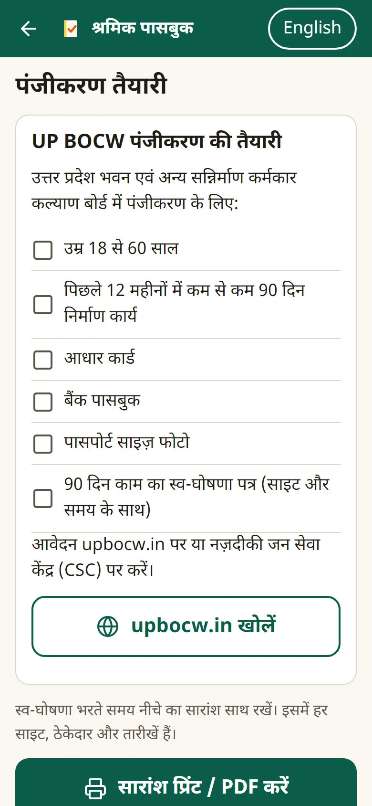

- What you need: age 18 to 60, at least 90 days of construction work in the last 12 months, Aadhaar card, bank passbook, passport size photo and the 90-day self-declaration.
- Apply at **upbocw.in** (button in the app) or at your nearest Jan Seva Kendra (CSC).

**"सारांश प्रिंट / PDF करें" से अपने काम का सारांश निकालें।**
**Use "सारांश प्रिंट / PDF करें" (Print / PDF summary) to get your work summary.**

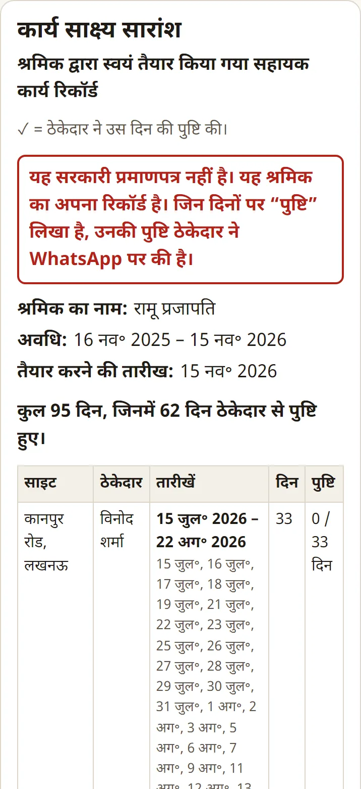

- The summary lists every site, contractor and date, with a ✓ on confirmed days. Keep it with you while filling the self-declaration.
- **यह सरकारी प्रमाणपत्र नहीं है।** It is **not a government certificate**. It is your own record; days marked confirmed were confirmed by the contractor on WhatsApp.

## 10. Settings

**"सेटिंग" में बैकअप, सारांश फ़ाइल और डेटा मिटाने के बटन हैं।**
**"सेटिंग" (Settings) has backup, the summary file and delete-all.**

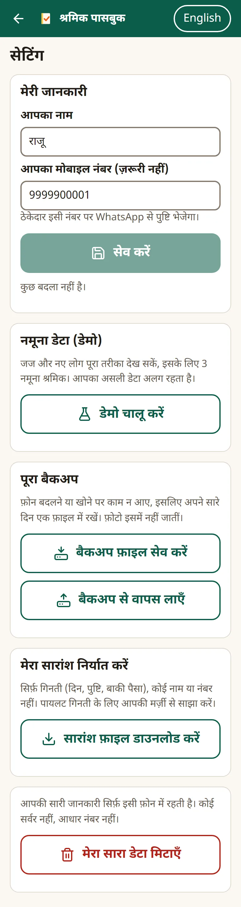

- **मेरी जानकारी** (My details): change your name or mobile number.
- **पूरा बैकअप** (Full backup): **बैकअप फ़ाइल सेव करें** saves all your days in one file; keep it safe. **बैकअप से वापस लाएँ** brings them back on a new phone. Photos are not in the backup.
- **मेरा सारांश निर्यात करें** (Export my summary): a file with counts only (days, confirmed days, money due), no names or numbers.
- **मेरा सारा डेटा मिटाएँ** (Delete all my data): wipes everything on this phone, after asking you.

**ऊपर "English" दबाकर ऐप अंग्रेज़ी में चलाएँ।**
**Tap "English" at the top to use the app in English. Tap "हिन्दी" to switch back.**

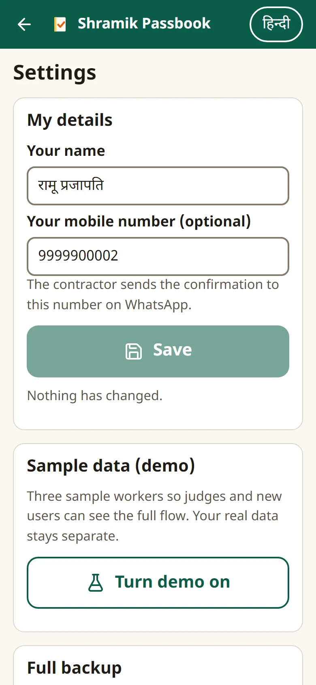

---

Back to the [README](../README.md).
